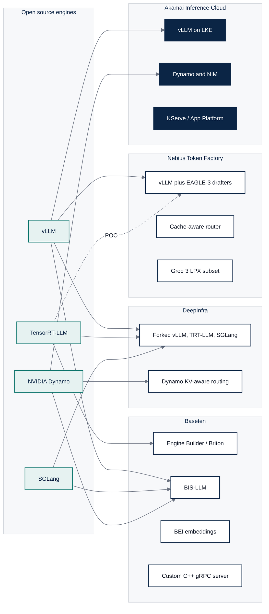
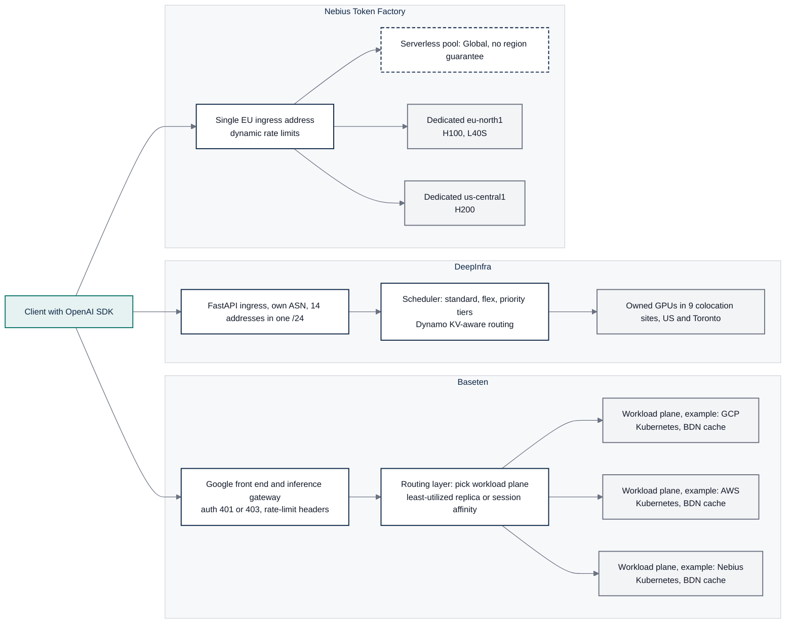

# 2. Technical Architecture & Engine Mechanics

Scope: how each platform turns an HTTP request into tokens, as of 2026-09-28. Where a platform
publishes configuration keys, the keys are quoted. Where it publishes nothing, the row says so.

## 2.1 Model comparison and availability

### Catalog shape

| Measure | Baseten | DeepInfra | Nebius Token Factory |
| --- | --- | --- | --- |
| Serverless LLM slugs | 11 on Model APIs (DeepSeek V4 family, GLM 5.2 and 5.3 family, Kimi K3, Nemotron 3 Ultra, gpt-oss-120b). Llama and Qwen appear only in the deployable library [B1] | 102 active text-generation models, 123 deprecated, 187 in the OpenAI-style listing; 385 entries across all modalities [P-CATALOG] | Roughly 25 serverless text models after the June and August deprecations removed 21 SKUs; 43 dedicated templates (33 text, 6 vision, 4 embedding) [N1][N2][P-OPENAPI] |
| Modalities on the per-token API | Chat, Anthropic Messages (beta), Whisper on Model APIs; TTS, STT, image, video, embeddings via dedicated library deploys [B1][B2] | Chat, completions, Responses, embeddings (28), rerank (4), image (47), video, TTS (15), ASR (8), music [P-CATALOG][P-OPENAPI] | Chat, completions, Responses, embeddings, rerank, image generation. No speech endpoints; Whisper request open for about a year [N3][P-OPENAPI] |
| Third-party model resale | Frontier Gateway routes to OpenAI, Anthropic, xAI, Vertex from the same key [P-OPENAPI] | 26 of 102 active text models are partner-proxied, mostly closed (Claude, Gemini, Qwen Max, Seed) [P-CATALOG] | None. Open weights only |
| Newest model added | DeepSeek V4 Pro 0813 day-zero (2026-08-13); GLM-5.3 day-0; Kimi K3 day-0 (2026-07-27) [B3][B4] | tencent/Hy4-preview 2026-09-25; DeepSeek V4.1 Flash 2026-09-10; MiMo V2.6 2026-09-22 [P-CATALOG] | "Day-one support" cited for Kimi K3, GLM-5.2, MiniMax M3, Nemotron 3 Ultra; Qwen3.8-2.4T day-0 on dedicated only [N4] |
| Deprecation behaviour | Six Model APIs retired 2026-09-25 with 12 days notice [B5] | "At least 1 week's advance notice"; requests to deprecated models are silently forwarded to a replacement model [D1][D2] | "Token Factory does not automatically reroute requests from deprecated models"; dedicated endpoints unaffected [N1] |
| Quantization disclosure | Per deployment; user chooses `quantization_type` (no_quant, fp8, fp8_kv, fp4, fp4_kv, fp4_mlp_only) [B6] | Per model in the public catalog: fp8 42, fp4 17, bfloat16 10, fp16 2, undeclared 31 of 102 active text models [P-CATALOG] | Per template flavor: fp8 33, fp16 8, fp4 4, int4 2, bf16 1 of 48 flavors [P-OPENAPI] |

### Flagship family coverage (open weights, per-token tier)

| Family | Baseten Model APIs | DeepInfra serverless | Nebius serverless |
| --- | --- | --- | --- |
| DeepSeek V4 (Pro, Flash, V4.1 Flash) | Yes, all three, plus cached-input pricing [B1] | Yes, 10 DeepSeek SKUs including V3, V3.1, V3.2, R1-0528 [P-CATALOG] | Yes, V4 Pro 0813, V4 Flash 0731, V4.1 Flash [N5] |
| Kimi K3 | Yes, 1M context [B1] | Yes, plus K2.6 [P-CATALOG] | Yes, NVFP4 with DSpark speculation [N6] |
| GLM 5.x | 5.2, 5.2 Fast, 5.3, 5.3 Fast, 5.3 Flash [B1] | 5.2, 5.3 (fp4), 5.3 Flash (fp4), 4.6, 4.7 [P-CATALOG] | 5.1, 5.2, 5.3, 5.3 Flash [N5] |
| gpt-oss-120b | Yes [B1] | Yes, three tiers (base bf16, Turbo, Ultra) [P-CATALOG] | Yes, fp4 [N7] |
| Qwen3.x | Not on Model APIs; library only [B1] | 21 Qwen3-family SKUs including 3.8-2.4T (fp4), 3.5-397B, 3.6, 3.8-Flash [P-CATALOG] | 3.5-397B, 3.8-27B, 3-235B-2507, 3-30B-2507 [N5] |
| Llama 3.x and 4 | Library only (Llama 3.3 70B TRT-LLM) [B2] | 7 SKUs: 3.3 70B Turbo (fp8, B200), 3.1 8B and 70B Turbo, Llama 4 Scout, Guard 4 [P-CATALOG] | Llama 3.3 70B removed from serverless 2026-08-31 [N2] |
| Nemotron 3 | Ultra 550B [B1] | Ultra, Super 120B, Nano 30B, 3.5 Lightning, Content Safety [P-CATALOG] | Ultra, Super, Nano, 3.5 Lightning [N5] |

### How each vendor markets its models

| Dimension | Baseten | DeepInfra | Nebius Token Factory |
| --- | --- | --- | --- |
| Catalog organization | Library filtered by task (LLM, transcription, TTS, image, embedding, computer use) with a "Trending models" section and publisher pages [B2] | Filters by category and by family, plus "featured", "Priority", and "Flex" badges [D20] | Three featured launches on the product page; public catalog of 25 models tagged by use (`code`, `function_calling`, `context_and_rag`, `reasoning`) [N8][N25] |
| Launch message | Day-0 is the headline: "day-0 support for Kimi K3" and "won't ruin launch day" [B4][B26] | Day-zero releases announced per model on the blog [D21] | Day-0 webinar and newsroom posts; lighter emphasis [N26] |
| Speed or price variants | Separate "Fast" SKUs at 1.5x price (GLM-5.3 Fast $2.10/$6.60 versus $1.40/$4.40) [B26] | Priority (+50%) and Flex (-20%) via `service_tier`; legacy "Turbo" and "Ultra" survive as model-name suffixes [D9][P-CATALOG] | Base and Fast flavors by `-fast` suffix; the public catalog lists no `-fast` IDs today [N9][N25] |
| Per-model page shows | Developer, size, license, price; library cards name GPU and engine (vLLM on H100, TRT-LLM, B200). No quantization or throughput [B2] | Precision and context (for example "bfloat16, 131,072"), zero-retention flag, cached and uncached prices [D20] | Quantization, context window, and a tokens-per-second figure per flavor in the public JSON [N25] |
| Customer use cases named | Code completion (Cursor, Zed), clinical documentation (Abridge, OpenEvidence), voice agents and TTS (Speechify) [B7] | Agent platforms ("more than 30% of token volume driven by autonomous agents"), OpenRouter supply, long-horizon coding [D3] | Coding agents, AI search, fraud and risk (Revolut), digital health (Sword Health), video generation (Higgsfield) [N8] |

Baseten markets launch speed and named logos, DeepInfra markets price and breadth, and Nebius
markets curated frontier models on owned capacity. Only Nebius puts a throughput number next to
each model, which is the closest any competitor comes to the serving contract in
[docs 4a](04a-strategic-output-product-management-brief.md).

## 2.2 Execution engines and runtimes

### Engine lineage per provider

| Provider | Serving engines in production (with evidence) | Proprietary layer |
| --- | --- | --- |
| Baseten | TensorRT-LLM through Engine-Builder-LLM (internal name Briton) for dense Llama, Qwen, Mistral; vLLM as the default backend of BIS-LLM for MoE and large dense models; SGLang for day-0 DeepSeek-class launches; custom containers may run vLLM, SGLang, TGI, TEI, Triton, llama.cpp; NVIDIA Dynamo for Model APIs [B8][B9][B10] | BEI embedding engine; a custom C++ gRPC server that replaced Triton; "proprietary inference engine" for DeepSeek V4 Pro with native MXFP4 [B3][B11] |
| DeepInfra | vLLM for "the bulk of the text-generation catalog"; SGLang; TensorRT-LLM plus NVIDIA Dynamo for KV-aware routing and disaggregated prefill and decode; NVFP4 via ModelOpt on B300 [D4][D5] | Maintained forks of vLLM, TensorRT-LLM, Dynamo, SGLang, and TGI under github.com/deepinfra; Rust tooling (deepctl, fastokens) [D6] |
| Nebius | vLLM in production ("supports the full set of vLLM parameters"; MiniMax-M3 "served on B200 via vLLM with EAGLE3"); TensorRT-LLM in at least one proof of concept; LMCache for long context; NVIDIA Groq 3 LPX adopted for a subset of models [N9][N6][N10][N11] | Custom cache-aware router; EAGLE-3 speculator training (SlimSpec, LK losses); Eigen AI kernels and sparsity work post-acquisition [N12][N13][N14] |

Shared lineage runs through the engine layer: all four platforms, Akamai included, run vLLM, and
all but Nebius also run NVIDIA Dynamo. Differentiation therefore lives in what is exposed to the
developer, the routing layer, and the capacity model, not in the engine.

TGI, named in the assessment brief, is no longer a live option. Hugging Face put Text Generation
Inference in maintenance mode on 2025-12-11, shipped its last release (v3.3.7) on 2025-12-19,
archived the repository on 2026-03-21, and recommends vLLM or SGLang instead [G1][G2]. None of the
three competitors uses TGI for its managed engines today: Baseten's custom-server guide names vLLM,
SGLang, and Triton (a custom container can still run TGI); DeepInfra's TGI fork was last pushed in December 2023 while its vLLM fork is active; Nebius
docs carry no TGI reference [B27][D22][N9]. A new serverless product should not plan on it.

### Mechanics: why batching decides serverless unit cost

Decode is memory-bandwidth bound: each generated token reads every active weight once, whether the
step serves 1 sequence or 200. Batching amortizes that read, so tokens per GPU-second, and
therefore price per token, scale with how many sequences share each step.

| Technique | How it works | Trade-off exposed to the buyer |
| --- | --- | --- |
| Static batching | Collect N requests, run them to completion together; short requests wait for the longest | Simple; high tail latency and idle slots. Not used by any of the three on shared tiers |
| Continuous (in-flight) batching | The scheduler admits and retires sequences at every decode step, so a finished sequence frees its slot immediately [R1] | Throughput rises with concurrency while per-request tokens/s falls. The operating point is the product decision: DeepInfra and Nebius encode it as a tier (Priority, Fast), Baseten as `max_batch_size` and scheduler policy |
| Chunked prefill | Long prompts are split into chunks interleaved with decode steps instead of stalling the batch [R2] | Keeps TTFT and inter-token latency stable for other users when one caller sends a 100K-token prompt; costs a little prefill efficiency |
| Admission control | When KV memory or batch slots run out, new requests queue or are rejected | Surfaces as 429 or 529 and `Retry-After` to the client; the tiering described below is admission control priced per request |

### How batching is exposed to the developer

| Control | Baseten (dedicated) | DeepInfra | Nebius |
| --- | --- | --- | --- |
| Batch size | `build.max_batch_size` 1 to 2,048, default 256; `runtime.max_batch_size` (v2) [B6] | Dedicated only: `max_batch_size` "controls parallel request capacity; excess requests queue". Serverless: none [D7][P-OPENAPI] | None on serverless. Fast flavor is defined as "smaller batch sizes, increased compute allocation" [N9] |
| Token budget per step | `build.max_num_tokens` 65 to 1,048,576, default 8,192; `max_num_batched_tokens` and `enable_chunked_prefill` on BIS-LLM [B6][B9] | Not exposed | Not exposed |
| Scheduler policy | `batch_scheduler_policy` guaranteed_no_evict or max_utilization; `enable_chunked_context` default true [B6] | Not exposed | Not exposed |
| Concurrency per replica | `runtime.predict_concurrency` default 1; UI concurrency target; guidance 32 to 128 for vLLM [B12] | 200 concurrent requests per model per account; 429 above [D8] | Dynamic rate limits in 15 minute windows, ceiling 20x base; `service_tier` flex or no-limit [N15] |
| Admission control | Backpressure policy `QUEUE_ON_FULL` or `REJECT_ON_FULL` (529 `request_backpressure_rejected`) [P-OPENAPI][B13] | `fail_fast` returns 429 immediately; Flex waits up to 10 minutes at 0.8x; Priority at 1.5x gets "protected admission" [D9][D10][P-OPENAPI] | 429 with `Retry-After`; over-limit requests may still run flagged `x-ratelimit-over-limit: yes`; 529 documented as "Inference service overloaded" [N15][P-OPENAPI] |
| Autoscaling signal | `concurrency_target`, `target_utilization_percentage`, `target_in_flight_tokens` (early access), `scale_down_delay` default 900 s, scheduled autoscaling [P-OPENAPI][B14] | `min_instances` (0 allowed), `max_instances` on dedicated [D7] | `scaling.min_replicas` and `max_replicas`, up to 32 per flavor (8 on three flavors), per-minute billing [P-OPENAPI][N16] |

Only Baseten exposes engine batching knobs. DeepInfra and Nebius sell batching as a service tier
(price multiplier or flavor suffix), which is simpler for the developer and opaque for capacity
planning.

## 2.3 Memory and KV cache management

### Mechanics: where GPU memory goes

After the weights, the KV cache (keys and values for every token of every live sequence) is the
largest consumer of GPU memory, and it grows with context length times concurrency. How a
platform manages it sets the maximum concurrent sequences per GPU, which sets the price floor.

| Technique | How it works | Effect |
| --- | --- | --- |
| Paged KV cache (PagedAttention) | KV stored in fixed-size blocks mapped through a table, like virtual memory, instead of one contiguous buffer per sequence [R3] | Near-zero fragmentation; more sequences per GPU; enables block sharing between sequences |
| Prefix caching | Blocks for an identical prompt prefix (system prompt, tool definitions, prior turns) are reused across requests instead of recomputed; a radix tree indexes shared prefixes in SGLang [R4] | Cuts prefill compute and TTFT on agent and chat traffic. Only pays off if the next request lands on the replica holding the blocks, hence KV-aware routing and session affinity |
| KV-aware routing | The router scores replicas by cached-prefix overlap as well as load | Converts prefix caching from a per-replica accident into a fleet-level hit rate; the source of the cached-input discounts below |
| KV quantization and offload | Store KV at FP8 or FP4, or spill cold blocks to host memory | More context per GPU; small accuracy risk (Baseten warns FP8 KV degrades Qwen2) |
| Speculative decoding | A small draft model or extra heads (EAGLE, MTP) propose several tokens; the target model verifies them in one pass [R5] | 2 to 3x lower inter-token latency at low concurrency; gains shrink as batch size grows because verification competes for the same compute |
| Disaggregated prefill and decode | Prefill (compute bound) and decode (bandwidth bound) run on separate GPU pools with KV transferred between them [R6] | Tunes each pool independently for TTFT versus tokens/s; needs a fast interconnect for the KV transfer |

Legend: Documented = named in vendor docs with a configuration key or price; Implied = named in a
blog or benchmark without a developer-facing control; Unknown = no public statement.

| Technique | Baseten | DeepInfra | Nebius |
| --- | --- | --- | --- |
| Paged KV cache | Documented: `plugin_configuration.paged_kv_cache`, `use_paged_context_fmha`, `kv_cache_free_gpu_mem_fraction` default 0.9, host offload via `kv_cache_host_memory_bytes` [B6] | Implied: inherited from vLLM and TRT-LLM forks [D6] | Implied: vLLM parameters supported [N9] |
| Prefix caching | Documented: `enable_prefix_caching` on BIS-LLM; Model APIs bill cached input at roughly 10% of input price (GLM-5.3 $0.14 vs $1.40); `x-session-affinity` header keeps a session on one replica to preserve the prefix [B9][B15][B16] | Documented: automatic, "even a single character difference will invalidate the cache"; cache-read pricing on 51 of 102 active models, 17 of them at 0.2x input (range 0.0084x to 0.7x); explicit retention with `prompt_cache_key` and TTL 5m (1.25x write) or 1h (2.0x write), 1,024 to 8,192 token granularity by model [D11][D12][P-CATALOG] | Implied: server-side caching mentioned, `usage.prompt_tokens_details.cached_tokens` returned, but no cached-input price. Feature request with 31 votes "In Review" [N9][N17][N18] |
| KV-aware routing | Documented: Dynamo router via `b10_routing_config` (overlap score weight, temperature); Enterprise only; vendor claims 50% TTFT reduction on Qwen3 480B [B17][B18] | Documented in blog: Dynamo KV-aware routing and Rust `kv-local-indexer` fork [D5][D6] | Documented in blog: custom cache-aware router, cache hit 95% vs 62% under Kubernetes ClusterIP routing [N12] |
| Speculative decoding | Documented: Eagle, MTP, NGram via `speculative_config`; lookahead on Engine Builder; custom EAGLE-3 head training; DFlash 3x on Qwen3-8B [B17][B19][B20] | Unknown: no blog or doc; only fork descriptions [D6] | Documented: Fast flavor uses it; custom speculator training API (EAGLE-3, `spec-draft`); ZDR opt-in "disables data storage and Speculative Decoding" [N9][N19][N20] |
| Quantization policy | Documented: FP8 on L4, H100, H200, B200; FP4 variants require B200; warning that FP8_KV degrades Qwen2 [B21] | Documented: "all-in" on FP4 with NVFP4 via ModelOpt; FP8 "Turbo" variants; context served at FP4 can drop (DeepSeek V4 Pro at 66k in the vendor's own April benchmark) [D13][D14] | Documented per template: fp8 default, fp4 and int4 for Kimi and gpt-oss; "approximately 99% of the original model's quality" [P-OPENAPI][N9] |
| Disaggregated prefill and decode | Documented: `is_disaggregated` with prefill and decode worker counts; "available on a limited basis" [B17] | Documented in blog via Dynamo [D5] | Implied: chat-app architecture post describes it in a POC [N10] |
| Data retention tied to caching | KV cache "remains in GPU memory during inference" and is not persisted [B22] | Zero retention by contract; inputs "not stored to disk during inference" [D15][D16] | Default retention of inputs and outputs "solely for Speculative Decoding", stored in Finland [N20] |

Two facts matter for a serverless product: DeepInfra has turned the KV cache into a priced,
programmable resource (read rate, write rate, TTL, granularity), and Nebius has coupled a privacy
setting to a performance feature, which forces regulated buyers to choose between residency and
speed.

## 2.4 Routing and multi-region topology

### Observed ingress (probe captures, 2026-09-29)

| Provider | Inference hostname resolves to | Front-end fingerprint | Regions and residency controls |
| --- | --- | --- | --- |
| Baseten | `inference.baseten.co` to one Google Cloud address (AS396982, global load balancer range); `api.baseten.co` to three Amazon addresses (AS16509) [P-DNS] | `via: 1.1 google` on every inference response; management API on gunicorn [P-API] | Workload planes are Kubernetes clusters, one per cloud region, 87 clusters across 18 clouds; `--region us` or `eu` at push; gateway endpoints carry a region enum `UNRESTRICTED` or `EU`; regional environments for US, EU, UK, Australia by support request [B23][B24][P-OPENAPI][B25] |
| DeepInfra | `api.deepinfra.com` to 14 addresses in one /24 announced by DeepInfra's own ASN (AS16581, DEEPINFRA-01) [P-DNS] | `server: uvicorn` (FastAPI); no CDN headers [P-API] | Eight US data centers plus Toronto (eStruxture colocation); no region parameter, no EU region; privacy policy states processing in the United States [D17][D18][D19] |
| Nebius | `api.studio.nebius.com` and `api.tokenfactory.nebius.com` to the same single address announced by Nebius's own ASN (AS214415, Nebius B.V., registered NL) [P-DNS] | FastAPI with Swagger UI at `/docs`; no CDN headers; `x-request-id` on every captured response [P-API][N21] | Serverless is "Global" with "no region guarantee"; dedicated data planes at eu-north1 (H100, L40S), us-central1 (H200), eu-west1; region fixed by contract, "no multi-region routing or automatic failover" [N22][N23][P-OPENAPI] |
| Akamai Cloud (baseline) | `api.linode.com` CNAME chain through `edgekey.net` to `akamaiedge.net` [P-DNS] | Akamai edge on the API, docs, and marketing hosts; `X-Akam-SW-Version`, `akaas` cookie [P-API] | 33 core regions in the regions API, 22 advertising GPU Linodes; RTX PRO 6000 in 20 regions; 4,400+ edge PoPs [P-REGIONS][A1][A2] |

### Request path

### Measured connection phases (probe, one US vantage point, 2026-09-29)

Nine unauthenticated GETs per host to an unknown route, so each server returns an error with
minimal work. No inference runs; these are a floor under TTFT, not a TTFT measurement [P-LAT].

| Host | Origin network | TCP connect p50 | TLS complete p50 | TTFB p50 (unknown route) |
| --- | --- | --- | --- | --- |
| `inference.baseten.co` | Google front end (AS396982) | 23 ms | 46 ms | 106 ms |
| `api.deepinfra.com` | DeepInfra (AS16581) | 36 ms | 74 ms | 112 ms |
| `api.linode.com` (Akamai baseline) | Akamai edge (AS20940) | 36 ms | 71 ms | 164 ms |
| `api.tokenfactory.nebius.com` | Nebius (AS214415, NL) | 142 ms | 285 ms | 465 ms |

Nebius pays a transatlantic round trip on every connection from the US, consistent with the
third-party TTFB table below. Baseten, DeepInfra, and Akamai sit within 60 ms of each other from a
US vantage point. Akamai's extra 52 to 58 ms of TTFB arrives mostly after TLS completes (all of it
against DeepInfra; 33 ms against Baseten, whose TLS also completes 25 ms sooner), consistent with
the hop from edge to the Linode API origin. The
edge advantage therefore shows up against single-site competitors for users far from that site,
not against Google's front end, and only if the inference gateway runs at the edge rather than
behind it.

### Latency implications

| Fact | Consequence |
| --- | --- |
| Nebius serverless ingress is one European address; edge TTFB p50 100 ms from Germany, 217 ms from US Central, 446 ms from Sao Paulo, 513 ms from Tokyo [N24][P-DNS] | Round trip alone consumes a fifth to half of a "sub-second" TTFT budget outside Europe |
| DeepInfra ingress is US-only; no anycast or CDN fingerprint [P-DNS][P-API] | Same penalty in reverse for European and Asian users, with no residency option |
| Baseten fronts inference with Google's global front end, then hops to a workload plane in another cloud (AWS, GCP, Nebius, OCI) [P-API][B23] | Two-hop path: edge terminates near the user, but the GPU may be a continent away; the `X-BASETEN-MODEL-PREDICTION-ATTEMPTS` header exposes internal retries [B13] |
| Akamai edge already terminates `api.linode.com` on Akamai's own network (AS20940), with 4,400+ PoPs claimed for AI Grid [P-DNS][A2] | Connection setup matches DeepInfra and trails Google's front end by 13 ms (TCP) and 25 ms (TLS); the rest of the 52 to 58 ms TTFB gap arrives after TLS, consistent with the edge-to-origin hop [P-LAT]. The ingress advantage is real for users far from a single-site competitor, and only materializes if gateway, auth, and cache run at the edge |

## Sources

Probe captures (this repository, 2026-09-29):

- [P-CATALOG] [evidence/derived/deepinfra-catalog.md](../evidence/derived/deepinfra-catalog.md)
- [P-OPENAPI] [evidence/derived/openapi-surface.md](../evidence/derived/openapi-surface.md)
- [P-DNS] [evidence/derived/dns-cdn.md](../evidence/derived/dns-cdn.md)
- [P-API] [evidence/derived/api-surface.md](../evidence/derived/api-surface.md)
- [P-REGIONS] [evidence/derived/akamai-regions.md](../evidence/derived/akamai-regions.md)
- [P-LAT] [evidence/derived/latency.md](../evidence/derived/latency.md)

Baseten:

- [B1] https://docs.baseten.co/inference/model-apis/overview
- [B2] https://www.baseten.co/library/
- [B3] https://www.baseten.co/blog/inference-engineering-for-deepseek-v4-pro-0813/ (2026-08-13)
- [B4] https://www.baseten.co/blog/how-to-build-a-day-zero-api-for-kimi-k3/ (2026-07-27)
- [B5] https://www.baseten.co/resources/changelog/
- [B6] https://docs.baseten.co/engines/engine-builder-llm/engine-builder-config
- [B7] https://www.baseten.co/resources/customers/
- [B8] https://docs.baseten.co/examples/tensorrt-llm
- [B9] https://docs.baseten.co/engines/bis-llm/overview
- [B10] https://www.baseten.co/blog/how-we-made-the-fastest-gpt-oss-on-nvidia-gpus-60-percent-faster/ (2025-10-24)
- [B11] https://www.baseten.co/blog/how-we-built-production-ready-speculative-decoding-with-tensorrt-llm/
- [B12] https://docs.baseten.co/deployment/autoscaling/overview
- [B13] https://docs.baseten.co/deployment/autoscaling/request-lifecycle
- [B14] https://docs.baseten.co/deployment/autoscaling/overview
- [B15] https://www.baseten.co/pricing/
- [B16] https://docs.baseten.co/inference/model-apis/pricing-and-limits
- [B17] https://docs.baseten.co/engines/bis-llm/advanced-features
- [B18] https://www.baseten.co/blog/how-baseten-achieved-2x-faster-inference-with-nvidia-dynamo/ (2026-03-16)
- [B19] https://www.baseten.co/blog/how-to-train-custom-eagle-3-heads-for-speculative-decoding/
- [B20] https://www.baseten.co/blog/dflash-faster-llm-inference/
- [B21] https://docs.baseten.co/engines/performance-concepts/quantization-guide
- [B22] https://docs.baseten.co/observability/security
- [B23] https://docs.baseten.co/hosting-options/self-hosted
- [B24] https://docs.baseten.co/deployment/regional-deployments
- [B25] https://docs.baseten.co/deployment/regional-environments
- [B26] https://www.baseten.co/products/model-apis/
- [B27] https://docs.baseten.co/development/model/custom-server

DeepInfra:

- [D1] https://docs.deepinfra.com/models
- [D2] https://github.com/theopenco/llmgateway/pull/4222
- [D3] https://siliconangle.com/2026/05/04/deepinfra-lands-107m-funding-build-dedicated-inference-cloud-open-source-models/
- [D4] https://deepinfra.com/blog/priority-service-tier (2026-06-29)
- [D5] https://deepinfra.com/blog/deepinfra-nvidia-inference-stack (2026-06-30)
- [D6] https://github.com/orgs/deepinfra/repositories
- [D7] https://docs.deepinfra.com/private-models/custom-llms
- [D8] https://docs.deepinfra.com/account/rate-limits
- [D9] https://docs.deepinfra.com/chat/overview
- [D10] https://deepinfra.com/blog/flex-service-tier (2026-07-14)
- [D11] https://docs.deepinfra.com/chat/prompt-caching
- [D12] https://deepinfra.com/blog/prompt-cache-retention (2026-08-05)
- [D13] https://x.com/DeepInfra/status/1958603893908414537
- [D14] https://deepinfra.com/blog/deepseek-v4-pro-max-api-benchmarks-latency-throughput-cost
- [D15] https://deepinfra.com/terms
- [D16] https://docs.deepinfra.com/account/data-privacy
- [D17] https://deepinfra.com/blog/deepinfra-series-b
- [D18] https://www.globenewswire.com/news-release/2026/07/08/3324125/0/en/DeepInfra-Expands-AI-Inference-Capacity-with-First-International-Data-Center-in-Toronto.html
- [D19] https://deepinfra.com/privacy
- [D20] https://deepinfra.com/models
- [D21] https://deepinfra.com/blog/cosmos3-release
- [D22] https://github.com/deepinfra/text-generation-inference (fork, last push 2023-12-15)

Nebius:

- [N1] https://docs.tokenfactory.nebius.com/june-2026-deprecation-notice.md
- [N2] https://docs.tokenfactory.nebius.com/august-2026-deprecation-notice.md
- [N3] https://ideas.nebius.com/p/ne-hvataet-podderzhki-whisper
- [N4] Nebius Q2 2026 shareholder letter (2026-08-12)
- [N5] https://mastra.ai/models/providers/nebius and https://openrouter.ai/provider/nebius
- [N6] https://tokenfactory.nebius.com/endpoints
- [N7] https://openrouter.ai/api/v1/models/openai/gpt-oss-120b/endpoints
- [N8] https://nebius.com/services/token-factory
- [N9] https://docs.tokenfactory.nebius.com/ai-models-inference/overview
- [N10] https://nebius.com/blog/posts/the-invisible-architecture-behind-great-chat-apps (2025-12-15)
- [N11] https://nebius.com/blog/posts/nvidia-groq-3-lpx-nebius-token-factory (2026-08-24)
- [N12] https://nebius.com/blog/posts/routing-is-the-difference-between-scaling-and-stalling (2026-02-17)
- [N13] https://nebius.com/blog/posts/slimspec-faster-speculative-decoding-without-cutting-the-vocabulary (2026-07-20)
- [N14] https://nebius.com/blog/posts/nebius-and-eigen-ai-partner-to-accelerate-frontier-open-source-ai-inference (2026-03-17)
- [N15] https://docs.tokenfactory.nebius.com/ai-models-inference/rate-limits
- [N16] https://docs.tokenfactory.nebius.com/ai-models-inference/dedicated-endpoints/billing-policy.md
- [N17] https://docs.tokenfactory.nebius.com/api-reference/inference/create-chat-completion.md
- [N18] https://ideas.nebius.com/p/support-impliciteexplicite-prompt-caching
- [N19] https://docs.tokenfactory.nebius.com/post-training/custom-speculator.md
- [N20] https://docs.tokenfactory.nebius.com/legal/legal-quick-guide.md
- [N21] https://docs.tokenfactory.nebius.com/api-reference/introduction.md
- [N22] https://docs.tokenfactory.nebius.com/public-serverless.md
- [N23] https://docs.tokenfactory.nebius.com/ai-models-inference/dedicated-endpoints/control-data-plane.md
- [N24] https://llmlatency.dev/provider/nebius (2026-09-28)
- [N25] https://tokenfactory.nebius.com/api/public/models_info and https://tokenfactory.nebius.com/model-catalog (2026-09-28)
- [N26] https://nebius.com/events/webinar-kimi-k3

Upstream projects:

- [G1] https://github.com/huggingface/text-generation-inference (README: maintenance mode; repository archived 2026-03-21)
- [G2] https://huggingface.co/docs/inference-endpoints/engines/tgi

Research papers:

- [R1] Yu et al., Orca: A Distributed Serving System for Transformer-Based Generative Models, OSDI 2022, https://www.usenix.org/conference/osdi22/presentation/yu
- [R2] Agrawal et al., SARATHI: Efficient LLM Inference by Piggybacking Decodes with Chunked Prefills, https://arxiv.org/abs/2308.16369
- [R3] Kwon et al., Efficient Memory Management for Large Language Model Serving with PagedAttention, SOSP 2023, https://arxiv.org/abs/2309.06180
- [R4] Zheng et al., SGLang: Efficient Execution of Structured Language Model Programs, https://arxiv.org/abs/2312.07104
- [R5] Leviathan et al., Fast Inference from Transformers via Speculative Decoding, ICML 2023, https://arxiv.org/abs/2211.17192
- [R6] Zhong et al., DistServe: Disaggregating Prefill and Decoding for Goodput-optimized LLM Serving, OSDI 2024, https://arxiv.org/abs/2401.09670

Akamai:

- [A1] https://techdocs.akamai.com/cloud-computing/docs/gpu-compute-instances
- [A2] https://www.akamai.com/newsroom/press-release/akamai-launches-ai-grid-intelligent-orchestration-for-distributed-inference-across-4400-edge-locations (2026-03-16)
