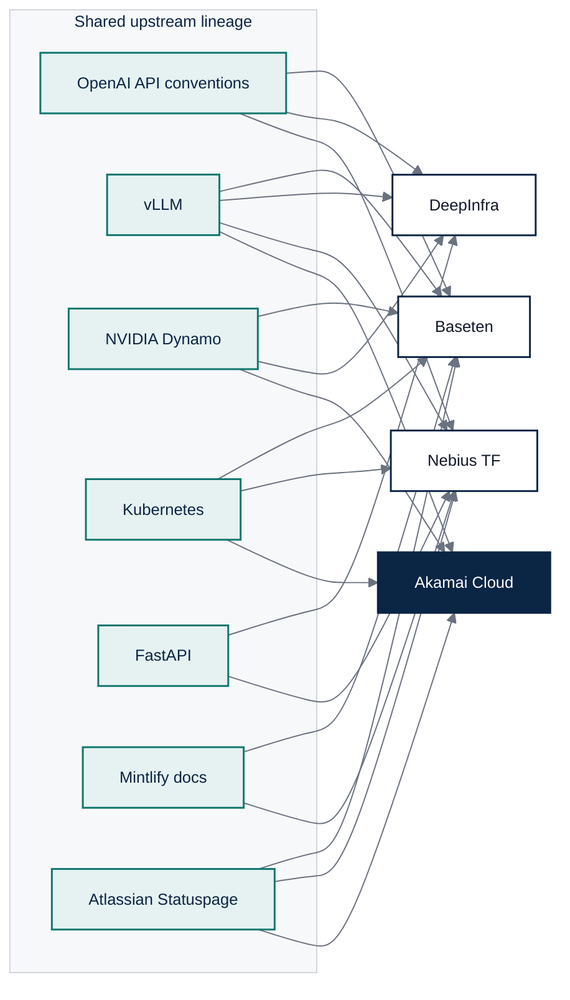

# 3. Developer Experience (DX) & API Surface Evaluation

Scope: what a developer touches, as of 2026-09-28. The compatibility matrix is built from three
sources with different trust levels: public OpenAPI specifications parsed mechanically
([evidence/derived/openapi-surface.md](../evidence/derived/openapi-surface.md)), unauthenticated
HTTP captures ([evidence/derived/api-surface.md](../evidence/derived/api-surface.md)), and vendor
documentation. Each cell names which.

## 3.1 API uniformity and OpenAI compatibility

### Endpoint surface

| Surface | Baseten | DeepInfra | Nebius Token Factory |
| --- | --- | --- | --- |
| OpenAI base URL | `https://inference.baseten.co/v1` (Model APIs); `https://model-{id}.api.baseten.co/environments/production/sync/v1` (dedicated) [B1][B2] | `https://api.deepinfra.com/v1/openai` [D1] | `https://api.tokenfactory.nebius.com/v1`; legacy `api.studio.nebius.com` still answers identically [P-API][N1] |
| Chat, completions, embeddings | Chat on Model APIs; completions and embeddings on dedicated, engine-dependent [B1][B2] | All three, plus `/v1/responses`, images, audio, videos, files, batches, models [P-OPENAPI] | All three, plus `/v1/rerank`, `/v1/responses`, images, files, fine-tuning, datasets, dedicated endpoints [P-OPENAPI] |
| OpenAI Responses API | No | Yes, first seen in the 2026-09-29 capture: `/v1/responses` with `previous_response_id`, `reasoning`, `tools` (function, `web_search`), `service_tier`, `store`, `stream`, `background`; `GET` and `DELETE` on `/v1/responses/{response_id}` are declared as not-found handlers, so stored responses are not retrievable [P-OPENAPI] | Yes: `/v1/responses` with `previous_response_id`, `reasoning`, `tools`, `service_tier`, `store`; POST only, no retrieval path [P-OPENAPI] |
| Anthropic Messages | `/v1/messages` (beta) [B1] | `/anthropic/v1/messages` and `count_tokens`, mapping open models onto Claude Code slots [P-OPENAPI][D2] | No |
| Batch API | None documented; async predict with webhooks on dedicated (priority 0 to 2, up to 72 h in queue) [B3][B4] | OpenAI-compatible `/v1/files` and `/v1/batches`, 20% discount, 24 h window, 50,000 lines per file [P-OPENAPI][D3] | `/v1/files` with `purpose=batch` exists but no `/v1/batches` path in the current spec; batch runs through Data Lab operations; the batch doc page returns 404 [P-OPENAPI][N2] |
| Public OpenAPI spec | Management API only: 160 paths, 211 operations at `api.baseten.co/v1/spec` [P-OPENAPI] | Full API: 140 paths, 169 operations at `api.deepinfra.com/openapi.json` [P-OPENAPI] | Inference API: 37 paths, 47 operations, version stamped `20260928-144ca2fd4`, Swagger UI at `/docs` [P-OPENAPI][P-API] |

### Chat completions parameter conformance (mechanical diff against the OpenAI request schema)

| Measure | DeepInfra | Nebius | Baseten |
| --- | --- | --- | --- |
| Declared parameters | 31 | 23 | No public schema; docs list the OpenAI set plus `x-session-affinity` header [B1] |
| OpenAI parameters absent | 15: `audio`, `function_call`, `functions`, `logit_bias`, `max_completion_tokens`, `metadata`, `modalities`, `parallel_tool_calls`, `prediction`, `prompt_cache_retention`, `safety_identifier`, `store`, `top_logprobs`, `verbosity`, `web_search_options` [P-OPENAPI] | 13: `audio`, `function_call`, `functions`, `metadata`, `modalities`, `parallel_tool_calls`, `prediction`, `prompt_cache_key`, `prompt_cache_retention`, `safety_identifier`, `seed`, `verbosity`, `web_search_options` [P-OPENAPI] | Not verifiable without a key |
| Vendor extensions | 11: `min_p`, `top_k`, `repetition_penalty`, `stop_token_ids`, `ignore_eos`, `continue_final_message`, `chat_template_kwargs`, `fail_fast`, `models` (ordered fallback list, up to 4), `prompt_cache_options` (TTL), `reasoning` [P-OPENAPI] | 1: `extra_body` pass-through to vLLM [P-OPENAPI] | `x-session-affinity` request header; `Api-Key` auth scheme accepted alongside Bearer [B1] |
| Documented response codes on the chat route | 200, 422 only [P-OPENAPI] | 200, 400, 401, 402, 403, 404, 422, 429, 500, 503, 529 [P-OPENAPI] | 400, 401, 402, 403, 404, 413, 429, 499, 500, 502, 503, 504, 529 in the errors guide [B5] |

Notable: DeepInfra omits `top_logprobs`, `logit_bias`, and `parallel_tool_calls` from its chat schema
while adding sampler controls the OpenAI SDK does not know. Nebius omits `seed`, which removes
reproducibility, and `prompt_cache_key`, which matches the absence of cached-input pricing.

### Streaming, errors, and headers (observed and documented)

| Behaviour | Baseten | DeepInfra | Nebius |
| --- | --- | --- | --- |
| Missing credentials (observed) | HTTP 401, body `{"error":"please check the api-key you provided"}`; `GET /v1/models` returns plain text "No Authorization header provided" [P-API] | HTTP 401, body `{"error":{"message":"missing API key","type":"invalid_request_error","param":null,"code":"invalid_api_key"}}`, `www-authenticate: Bearer` [P-API] | HTTP 401, body `{"detail":"Couldn't authenticate. Reason: token is not present"}` [P-API] |
| Invalid credentials (observed) | HTTP 403 (OpenAI returns 401) with the same string body [P-API] | HTTP 401, OpenAI-shaped error object, `code: invalid_api_key` [P-API] | HTTP 401, FastAPI `detail` string [P-API] |
| Unknown route (observed) | HTTP 405 with empty body [P-API] | HTTP 404 `{"detail":"Not Found"}` [P-API] | HTTP 404 `{"detail":"Not Found"}` [P-API] |
| Error schema conformance | Not OpenAI-shaped: `{"error": "<string>"}` [B5][P-API] | OpenAI-shaped on the OpenAI route; FastAPI `detail` on native and 404 routes [P-API] | Not OpenAI-shaped: FastAPI `detail` [P-API] |
| Streaming usage | `stream_options.include_usage` yields a final chunk [B1] | Usage on the final chunk before `[DONE]` by default (`include_usage` defaults to true); `usage.estimated_cost` documented on non-streaming responses [D4][D18] | `stream_options.include_usage` yields usage in the final chunk [N3] |
| Rate-limit headers | `x-ratelimit-limit-requests`, `-remaining-requests`, `-limit-tokens`, `-remaining-tokens`, plus split `-uncached-input-tokens` and `-output-tokens` [B6] | None documented [D5] | `x-ratelimit-limit-*`, `-remaining-*`, `-reset-*`, plus `x-ratelimit-dynamic-scale-*`, `x-ratelimit-dynamic-period-*`, `x-ratelimit-over-limit`, `Retry-After` [N4] |
| Request identifier | `X-Baseten-Request-Id` on predict; `X-BASETEN-MODEL-PREDICTION-ATTEMPTS` exposes retries [B7][B8] | None documented; request IDs are visible only through `/v1/request-costs` [D6] | `x-request-id`, observed on every captured response [N1][P-API] |
| Overload signal | 529 with optional `Retry-After` [B5] | 429 "Rate limited"; Flex tier may wait up to 10 minutes then 429 [D5][D7] | 529 "Inference service overloaded"; 402 on exhausted budget [P-OPENAPI][N4] |
| CORS on the inference route (observed) | OPTIONS returns 204 with `access-control-allow-methods: POST` and the request origin echoed [P-API] | OPTIONS returns 200 "OK" [P-API] | OPTIONS returns 204 [P-API] |
| Timeouts | Server-side default 1,200 s for predict and 1,200 s for parking; server-side tool calls need a client read timeout above 285 s [B8][B24] | Not documented; at-capacity requests queue unless `fail_fast` is set [D20] | Not documented [N1] |

### Streaming response format (documentation and OpenAPI spec)

No provider was called with a key, so every cell below is documented behavior, not observed.

| Element | Baseten Model APIs | DeepInfra | Nebius Token Factory |
| --- | --- | --- | --- |
| Framing | Server-sent events; `[DONE]` terminator not stated [B24] | `data:` lines ending in `data: [DONE]` [D4] | Data-only SSE "terminated by a `data: [DONE]` message" [N3] |
| Chunk object | `chat.completion.chunk` [B24] | `chat.completion.chunk` [D4] | `chat.completion.chunk` [P-OPENAPI] |
| Reasoning in deltas | `reasoning_content` documented on the message; the delta schema lists only role, content, tool_calls [B24][B25] | `reasoning_content` "in both the final message and each streaming delta" [D17] | Delta schema declares both `reasoning_content` and `reasoning` [P-OPENAPI] |
| Tool-call deltas | `tool_calls` in the delta schema [B24] | Not documented; the spec has no chunk schema [P-OPENAPI] | `tool_calls` in the delta schema [P-OPENAPI] |
| Usage chunk | Opt-in with `include_usage: true` [B24] | On by default; `continuous_usage_stats` opt-in [D8] | Opt-in; null on every chunk except the last [P-OPENAPI] |
| Error mid-stream | Stream ends early; web search emits a final `{"error": {...}}` data frame [B5][B29] | Not documented | Documented example: `data: {"error": {...}}` then `data: [DONE]` [P-OPENAPI] |
| Keep-alive | `: keep-alive` comment every 15 s, documented for server-side tool execution only [B24] | Not documented | Not documented |

A client written against the OpenAI SDK handles all three for content and tool calls. Reasoning
tokens diverge: a parser that reads only `reasoning_content` misses Nebius responses that use
`reasoning`, and Baseten does not document where reasoning appears when streaming.

### SDKs and client parameters

| Element | Baseten | DeepInfra | Nebius Token Factory |
| --- | --- | --- | --- |
| Recommended client | OpenAI SDK with base URL and key swapped [B24] | OpenAI SDK pointed at `/v1/openai` [D1][D20] | OpenAI SDK with `base_url` set [N1] |
| First-party packages | `truss` (packaging), Baseten CLI, `baseten_performance_client` (Python, npm, Rust) for batched high-throughput calls [B9][B26] | `deepinfra` npm client for the native API; `deepinfra` pip package for sandboxes; `deepctl` [D19][D9] | None for inference; sandbox SDK only [N5] |
| Sampler extensions outside the OpenAI schema | `top_k` (default 50), `min_p`, `repetition_penalty`, `chat_template_args` via `extra_body` [B24][B25] | `top_k` (0 = off), `min_p`, `repetition_penalty`, `chat_template_kwargs`, `continue_final_message`, `ignore_eos` [D8] | `extra_body` pass-through (for example `guided_json`); `top_k` shown in examples [P-OPENAPI][N19] |
| Framework integrations listed | LangChain, LlamaIndex, LiteLLM, Vercel AI SDK, LiveKit, coding agents [B27] | LangChain `ChatDeepInfra`, LlamaIndex, Vercel `@ai-sdk/deepinfra`, CrewAI, AutoGen [D1] | LangChain `langchain-nebius`, LiteLLM, LlamaIndex, CrewAI, Google ADK, Pydantic, Strands, Agno [N18] |

The extension names differ for the same function: `chat_template_args` at Baseten versus
`chat_template_kwargs` at DeepInfra. Both control reasoning toggles on hybrid models, so agent
frameworks carry per-provider shims for them.

### Default runtime settings

| Setting | Baseten | DeepInfra | Nebius Token Factory |
| --- | --- | --- | --- |
| `max_tokens` when omitted | 4,096 [B24] | Conflicting docs: spec says min(context minus input, 65,536); guide says "hard cap of 16384 tokens for most models" [D8][D20] | 8,192 [N3] |
| Served context versus model ceiling | "can differ from a model's advertised maximum"; reservation throttled to 49,512 tokens when unspecified [B1][B24] | 400 when context is exceeded; no served-versus-ceiling statement [D20] | Prompt plus `max_tokens` bounded by model context; no served-versus-ceiling statement [N3] |
| Default temperature | null (model default) [B24] | 1.0 [D20] | 1 [P-OPENAPI] |
| Serverless rate limit | Basic 15 RPM and 100K TPM unverified, 120 RPM verified; Pro 120 RPM and 1M TPM [B6] | 200 concurrent requests per model [D5] | Example baseline 60 RPM and 400K TPM, rising 20% per 15 minute window to 20x [N4] |
| Dedicated autoscaling defaults | Min 0, max 1, window 60 s, scale-down delay 900 s, concurrency target 1, utilization 70% [B28] | `min_instances` and `max_instances` set by the user; 4 GPU limit per user [D10] | `min_replicas` and `max_replicas` required, no defaults [N20] |

Default output caps differ by 2x to 16x across providers. A workload ported without an explicit
`max_tokens` changes behavior, which is a conformance item for any new OpenAI-compatible endpoint.

## 3.2 Control plane versus data plane

| Dimension | Baseten | DeepInfra | Nebius Token Factory |
| --- | --- | --- | --- |
| CLI | Truss (Python) for packaging plus Baseten CLI 1.0 (binary, `--output json`, `--jq`) for management, GA 2026-09-15 [B9][B10] | `deepctl` (Rust): auth, model list, deploy, infer, log query [D9] | None for inference; Sandboxes CLI and MCP server only; Nebius AI Cloud CLI for SSO federation [N5][N6] |
| Deployment artifact | `config.yaml` (Truss): Python version, requirements, accelerator, `docker_server` with custom image, `weights` from hf, s3, gs, r2, azure; `trt_llm` and `bis_llm` engine blocks [B11] | Hugging Face repo ID plus GPU type and instance counts; no custom container on serverless or custom LLM; "Quantization is not currently supported (in progress)" [D10] | Template name plus flavor plus `gpu_type`, `gpu_count`, `region`, `scaling` via `POST /v0/dedicated_endpoints`; custom weights "in beta and available on request" [P-OPENAPI][N7] |
| Management API | 160 paths: models, deployments, environments, promotions with pause and resume, autoscaling schedules, chains, training, loops, volumes, gateway, routes, billing, audit logs [P-OPENAPI] | 140 paths: dedicated models, LoRA, GPU rentals, sandboxes, agents, files and batches, billing, auth [P-OPENAPI] | 37 paths: inference, files, fine-tuning, dedicated endpoints (v0), datasets, operations [P-OPENAPI] |
| Environments and promotion | Development, production, custom environments; rolling promotion with pause, resume, cancel, force roll forward; canary deprecated [B12][P-OPENAPI] | Deploy IDs and model versions (`MODEL:VERSION`, `deploy_id:ID`); config history with restore [P-OPENAPI][D1] | Endpoint `enabled` toggle and PATCH; no environment concept [P-OPENAPI] |
| CI integration | GitHub Action `basetenlabs/action-truss-push` [B13] | None first-party | None first-party |
| Infrastructure as code | None | None | Terraform provider covers Nebius AI Cloud, not Token Factory [N8] |
| Identity and teams | Teams, restricted environments (403 to unauthorized keys), Viewer role, API keys prefixed `b10_` from 2026-10-01 [B14][B15] | GitHub, Google, Okta login; scoped JWTs; per-key spend limits [P-OPENAPI][D11] | Organizations, projects, groups; SAML SSO via cloud CLI; no SCIM; no spend limits documented [N9][N10] |

### Observability exposed to the developer

| Metric | Baseten | DeepInfra | Nebius |
| --- | --- | --- | --- |
| TTFT | Yes: time-to-first-byte p50 to p99 and Model API TTFT panels [B16] | Platform-wide only via public `/v1/metrics/live`; captured 0.42 s [P-LIVE] | Dedicated endpoints only, streaming requests only [N11] |
| Tokens per second | Yes, including decode TPS per BIS-LLM worker [B16] | Platform-wide only [P-LIVE] | Dedicated only [N11] |
| Queue delay | Async queue time and size; concurrent requests per replica [B16] | Not exposed; only `runtime_ms` in native responses [D12] | Not exposed |
| KV cache hit rate | Yes on BIS-LLM [B16] | Not exposed | Yes on dedicated [N11] |
| Cold start indicator | Replicas starting versus active; `cold_start="1"` log label [B16][B17] | Not applicable | Replica status Warning and Partially ready [N12] |
| Export | Prometheus endpoint (beta, six scrapes per minute per org), OTLP logs to Datadog, Grafana, Honeycomb, Sentry; OpenTelemetry tracing [B18][B19] | None; logs via API and `deepctl log query` [D9] | Prometheus federation URL with 15 s minimum scrape [N13] |

## 3.3 Architectural overlap with Akamai Cloud

The question is where the three competitors and Akamai Cloud share lineage, and where Akamai is
structurally different. The evidence is header fingerprints, DNS chains, OpenAPI conventions, and
documented stacks.

| Layer | Baseten | DeepInfra | Nebius | Akamai Cloud (Linode API v4, Inference Cloud) |
| --- | --- | --- | --- | --- |
| Serving engine | vLLM, SGLang, TensorRT-LLM, Dynamo [B20] | vLLM, SGLang, TensorRT-LLM, Dynamo [D13] | vLLM, TensorRT-LLM POC [N14] | vLLM, KServe, NVIDIA Dynamo, NIM pre-configured on LKE [A1] |
| Orchestration | Kubernetes, one cluster per cloud region; Calico and Cilium isolation [B21][B22] | No public Kubernetes reference; Kata Containers microVMs for sandboxes [D14] | Kubernetes (routing benchmark against ClusterIP); Managed Kubernetes and Soperator products [N15] | LKE and LKE-Enterprise (Cilium CNI); App Platform installs KServe with Istio and Knative [A2][A3] |
| API framework fingerprint | Inference behind Google front end; management API on gunicorn [P-API] | FastAPI on uvicorn; `{"detail": ...}` errors [P-API] | FastAPI with Swagger UI; `{"detail": ...}` errors [P-API] | Linode API: `{"errors":[{"reason","field"}]}`; `X-RateLimit-Limit`, `X-RateLimit-Remaining`, `Retry-After` on 200, 401, and OPTIONS responses (absent on the captured 404) [P-API][A4] |
| Ingress and CDN | Google Cloud (inference) and AWS (management); no CDN vendor headers [P-DNS] | Own ASN (AS16581), one /24; no CDN [P-DNS] | Own ASN (AS214415), single NL-registered address; no CDN [P-DNS] | Akamai edge (`edgekey.net`, `akamaiedge.net`) on API, docs, and marketing hosts [P-DNS] |
| Docs platform | Mintlify on Vercel with Cloudflare cache (`cf-cache-status`) [P-API][P-DNS] | Vercel (`server: Vercel`) [P-API] | Mintlify on Vercel [P-DNS] | ReadMe on Akamai edge; publishes `llms.txt` and an `agent-skills` discovery index [P-API] |
| Status page | Atlassian Statuspage, 6 product components [P-STATUS] | Custom Next.js page, per-model components, no public incident API [P-API][D15] | Atlassian Statuspage, 161 components grouped by region, Token Factory per region [P-STATUS] | Atlassian Statuspage, per-region and per-service components [P-STATUS] |
| Auth scheme | Bearer and legacy `Api-Key` [B1] | Bearer; scoped JWT [P-OPENAPI] | Bearer [P-OPENAPI] | Bearer personal access token or OAuth [A4][P-OPENAPI] |
| Machine-readable model catalog | Management API `/v1/model_apis` with `cost_per_million_input_tokens`, `rate_limits`, `release_date` (auth required) [P-OPENAPI] | Public: `/models/list` with quantization, deprecation, `replaced_by`, `is_partner`, per-tier pricing [P-CATALOG] | `/v1/models?verbose=true` (auth) and public dedicated templates with quantization and GPU by region [P-OPENAPI][N16] | Regions API advertises GPU capability per region; no model catalog exists yet [P-REGIONS] |
| Hosting relationship with Akamai | None found. Baseten runs on Nebius, AWS, GCP, OCI [B23] | None found [D16] | None found; only an ex-Akamai sales executive hire [N17] | Not applicable |

### What the overlap means for an Akamai serverless product

1. Engine parity is free. vLLM and Dynamo on LKE already match the competitor engine layer, so
   the product decision is which knobs to expose (Baseten style) versus which tiers to sell
   (DeepInfra and Nebius style).
2. API conventions do not overlap. The Linode error envelope and capitalized rate-limit headers
   differ from the OpenAI error object and lowercase `x-ratelimit-*` headers every competitor
   uses. A serverless endpoint must speak the OpenAI dialect on the data plane while the control
   plane keeps Linode conventions, and the seam must be documented.
3. Ingress is where Akamai can lead, but does not yet. DeepInfra terminates TLS in one /24 and
   Nebius at one address, each in its own network; Baseten uses Google's global front end, which measured fastest
   on every connection phase from a US vantage point. Akamai terminates `api.linode.com` at its
   own edge and lands 58 ms behind Baseten on a minimal request: 25 ms in connection setup, the rest
   after TLS, consistent with the edge-to-origin hop [P-LAT]. The lead exists only if the inference gateway runs at the edge.
4. Nothing in any competitor's public surface references Akamai or Linode, so there is no
   channel conflict and no shared infrastructure to protect.

## Sources

Probe captures (this repository, 2026-09-29):

- [P-OPENAPI] [evidence/derived/openapi-surface.md](../evidence/derived/openapi-surface.md)
- [P-API] [evidence/derived/api-surface.md](../evidence/derived/api-surface.md)
- [P-DNS] [evidence/derived/dns-cdn.md](../evidence/derived/dns-cdn.md)
- [P-STATUS] [evidence/derived/status-incidents.md](../evidence/derived/status-incidents.md)
- [P-CATALOG] [evidence/derived/deepinfra-catalog.md](../evidence/derived/deepinfra-catalog.md)
- [P-REGIONS] [evidence/derived/akamai-regions.md](../evidence/derived/akamai-regions.md)
- [P-LIVE] `evidence/probes/deepinfra/live_metrics.body`
- [P-LAT] [evidence/derived/latency.md](../evidence/derived/latency.md)

Baseten:

- [B1] https://docs.baseten.co/inference/model-apis/overview
- [B2] https://docs.baseten.co/inference/calling-your-model
- [B3] https://docs.baseten.co/reference/inference-api/overview
- [B4] https://docs.baseten.co/inference/async
- [B5] https://docs.baseten.co/inference/errors
- [B6] https://docs.baseten.co/inference/model-apis/pricing-and-limits
- [B7] https://docs.baseten.co/development/model/custom-server
- [B8] https://docs.baseten.co/deployment/autoscaling/request-lifecycle
- [B9] https://docs.baseten.co/reference/cli/truss/overview
- [B10] https://docs.baseten.co/reference/cli/baseten/overview
- [B11] https://docs.baseten.co/reference/truss-configuration
- [B12] https://docs.baseten.co/deployment/deployments
- [B13] https://docs.baseten.co/deployment/ci-cd
- [B14] https://docs.baseten.co/organization/restricted-environments
- [B15] https://www.baseten.co/resources/changelog/
- [B16] https://docs.baseten.co/observability/metrics
- [B17] https://github.com/basetenlabs/truss/pull/2659
- [B18] https://docs.baseten.co/observability/export-metrics/overview
- [B19] https://docs.baseten.co/observability/tracing
- [B20] https://docs.baseten.co/engines/bis-llm/overview
- [B21] https://docs.baseten.co/hosting-options/self-hosted
- [B22] https://docs.baseten.co/observability/security
- [B23] https://www.baseten.co/blog/ai-video-nebius-baseten-inference-stack/
- [B24] https://docs.baseten.co/reference/inference-api/chat-completions
- [B25] https://docs.baseten.co/inference/model-apis/reasoning
- [B26] https://docs.baseten.co/reference/sdk/performance-client/overview
- [B27] https://docs.baseten.co/inference/integrations
- [B28] https://docs.baseten.co/deployment/autoscaling/overview
- [B29] https://docs.baseten.co/inference/model-apis/web-search

DeepInfra:

- [D1] https://docs.deepinfra.com/
- [D2] https://docs.deepinfra.com/integrations/anthropic
- [D3] https://docs.deepinfra.com/batch/introduction
- [D4] https://docs.deepinfra.com/chat/streaming
- [D5] https://docs.deepinfra.com/account/rate-limits
- [D6] https://docs.deepinfra.com/api-reference/logs-&-metrics/get-request-costs
- [D7] https://deepinfra.com/blog/flex-service-tier
- [D8] https://docs.deepinfra.com/api-reference/chat-completions/openai-chat-completions
- [D9] https://github.com/deepinfra/deepctl
- [D10] https://docs.deepinfra.com/private-models/custom-llms
- [D11] https://docs.deepinfra.com/api-reference/billing/set-key-limit.md
- [D12] https://docs.deepinfra.com/account/webhooks
- [D13] https://deepinfra.com/blog/priority-service-tier
- [D14] https://docs.deepinfra.com/sandboxes/overview
- [D15] https://status.deepinfra.com/
- [D16] https://www.edgeir.com/deepinfra-closes-107m-series-b-to-expand-global-ai-inference-cloud-20260514
- [D17] https://docs.deepinfra.com/integrations/microsoft-agent-framework
- [D18] https://docs.deepinfra.com/quickstart
- [D19] https://docs.deepinfra.com/apis/deepinfra-native
- [D20] https://docs.deepinfra.com/chat/overview

Nebius:

- [N1] https://docs.tokenfactory.nebius.com/api-reference/introduction.md
- [N2] https://docs.tokenfactory.nebius.com/data-lab/overview.md
- [N3] https://docs.tokenfactory.nebius.com/api-reference/inference/create-chat-completion.md
- [N4] https://docs.tokenfactory.nebius.com/ai-models-inference/rate-limits
- [N5] https://docs.tokenfactory.nebius.com/sandboxes/cli/index.md
- [N6] https://docs.tokenfactory.nebius.com/team-access/sso.md
- [N7] https://docs.tokenfactory.nebius.com/ai-models-inference/dedicated-endpoints/custom-weights.md
- [N8] https://registry.terraform.io/providers/nebius/nebius/latest
- [N9] https://docs.tokenfactory.nebius.com/team-access/org-projects.md
- [N10] https://ideas.nebius.com/
- [N11] https://docs.tokenfactory.nebius.com/ai-models-inference/observability.md
- [N12] https://docs.tokenfactory.nebius.com/ai-models-inference/dedicated-endpoints/lifecycle-and-status.md
- [N13] https://docs.tokenfactory.nebius.com/ai-models-inference/observability-api-integrations.md
- [N14] https://docs.tokenfactory.nebius.com/ai-models-inference/overview
- [N15] https://nebius.com/blog/posts/routing-is-the-difference-between-scaling-and-stalling
- [N16] https://docs.tokenfactory.nebius.com/api-reference/examples/list-of-models.md
- [N17] https://www.stocktitan.net/news/NBIS/nebius-names-dan-lawrence-to-lead-expansion-in-the-us-as-senior-vice-9al23hqigmjf.html
- [N18] https://docs.tokenfactory.nebius.com/integrations/overview
- [N19] https://docs.tokenfactory.nebius.com/api-reference/examples/text-generation
- [N20] https://docs.tokenfactory.nebius.com/ai-models-inference/dedicated-endpoints/operating

Akamai:

- [A1] https://www.akamai.com/products/akamai-inference-cloud-platform
- [A2] https://techdocs.akamai.com/cloud-computing/docs/lke-enterprise
- [A3] https://www.akamai.com/cloud/guides/deploy-llm-for-ai-inferencing-on-apl
- [A4] https://techdocs.akamai.com/linode-api/reference/errors and https://techdocs.akamai.com/linode-api/reference/rate-limits
